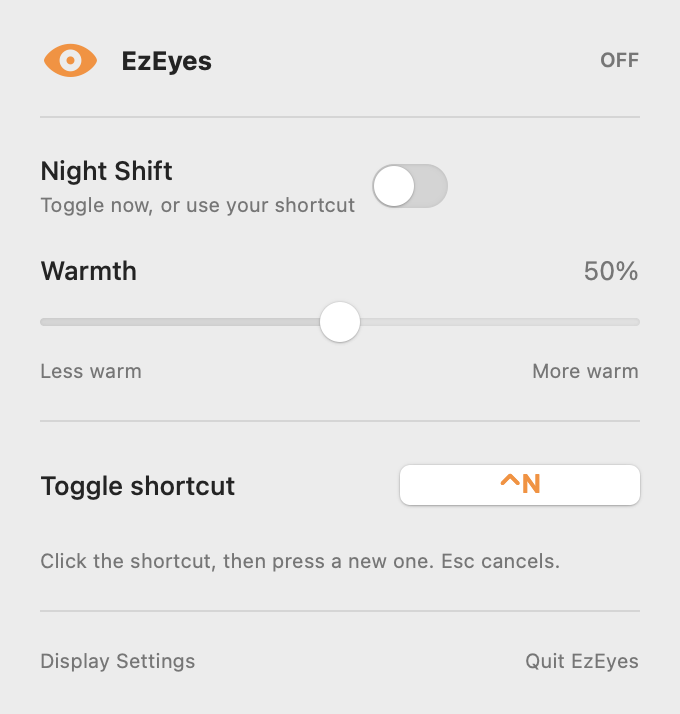

# EzEyes

EzEyes puts Night Shift controls in your Mac's menu bar. Click the eye to open the switch, warmth slider, and shortcut setting. Press **Control-N (⌃N)** to toggle Night Shift from anywhere; you can change the shortcut in the app.



## Build and run

You need macOS 13 or later and Swift 5.9 or later. Apple's Command Line Tools are enough; if `swift --version` fails, run `xcode-select --install`.

```sh
git clone https://github.com/teoh/ezeyes.git
cd ezeyes
zsh scripts/build-app.sh
open dist/EzEyes.app
```

For a ZIP download, choose **Code → Download ZIP** on GitHub and unzip it. In Terminal, type `cd `, drag the extracted folder in, press Return, then run the last two commands above. The script builds the app on your Mac. The repo has no prebuilt app or third-party dependencies. Look for the eye in the menu bar; EzEyes has no Dock icon.

## Install and update

Running from `dist/` is fine. To keep a copy in your Applications folder, quit EzEyes and run:

```sh
mkdir -p "$HOME/Applications"
ditto dist/EzEyes.app "$HOME/Applications/EzEyes.app"
open "$HOME/Applications/EzEyes.app"
```

To update, quit EzEyes, run `git pull` (if you cloned it), rebuild, and copy the new app with `ditto` again. Run only one copy at a time so the shortcut works reliably.

## Uninstall

Choose **Quit EzEyes** in its panel. Remove the installed copy and saved shortcut:

```sh
rm -rf "$HOME/Applications/EzEyes.app"
defaults delete com.mat.ezeyes 2>/dev/null || true
```

Then delete the source folder, including its `dist/` and `.build/` folders. If you installed EzEyes elsewhere, delete that copy too. EzEyes installs no login item or helper.

## Notes

EzEyes has no network code and saves only your shortcut on your Mac. It uses a Night Shift control that Apple may change in a macOS update. macOS may warn about a locally built app, and managed Macs may block it; see [Apple's guide](https://support.apple.com/en-us/102445). Control-N also moves down one line in some text fields, so change it if it conflicts.
